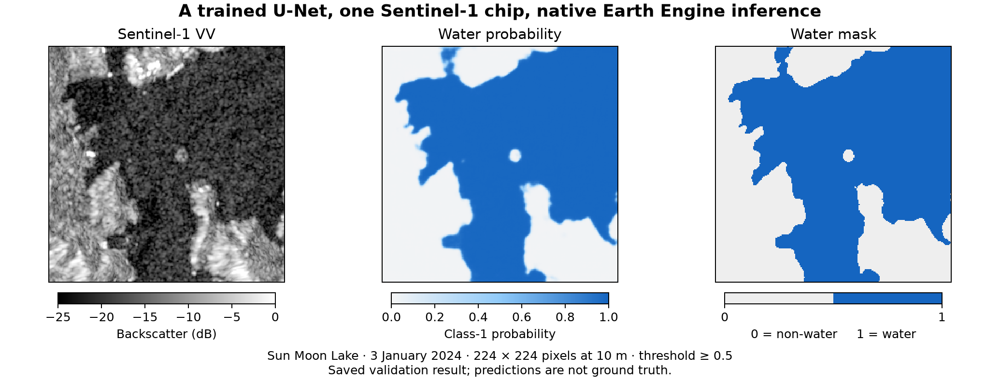

# TensorEE

[](https://github.com/noelEOS/tensor-ee/actions/workflows/tests.yml)

**TensorEE runs pretrained PyTorch models natively inside Google Earth Engine**: the whole
forward pass is Earth Engine image and array operations, with no model-serving endpoint.



*A trained ResNet18 U-Net run inside Earth Engine on one 224 × 224 Sentinel-1 chip: Sun Moon
Lake, Taiwan, 3 January 2024. The water mask is a model prediction, not ground truth
([validation](docs/validation.md), [walkthrough](docs/water-chip.md)). Contains modified
Copernicus Sentinel data (2024).*

## How it works

```text
PyTorch model ──▶ TensorEE blocks ──▶ one Earth Engine graph ──▶ export or map layer
```

Each layer becomes a block of Earth Engine operations, built in Python with the Earth Engine
client, and the weights travel in the request as constants or as Earth Engine table assets.
What the library cannot express is refused, not approximated.

## Try it in the Code Editor

No install and no checkpoint: the trained U-Net's weights are public Earth Engine table
assets, under CC BY 4.0. You need an Earth Engine account and a Cloud project
[registered for Earth Engine](https://developers.google.com/earth-engine/guides/access), where
you can create an image asset.

1. In the [Code Editor](https://code.earthengine.google.com/), create a repository named
   `segwater` (the name `inference.js` expects) and in it a script named `segwater`. Paste the
   whole of [`demos/code_editor/segwater.js`](demos/code_editor/segwater.js) (on GitHub,
   **Copy raw file**) and save.
2. In the same repository, create a script named `inference` and paste
   [`demos/code_editor/inference.js`](demos/code_editor/inference.js). In
   `require('users/YOUR_USERNAME/segwater:segwater')`, replace `YOUR_USERNAME` with your Code
   Editor user name: the **Scripts** tab lists your repository under **Owner** as
   `users/<name>/segwater`. Save. (If the path is wrong, **Run** stops with a Console error
   naming it, for example `Cannot find required repo: users/YOUR_USERNAME/segwater:segwater`.)
3. Click **Run**, then **Find scenes**, enter an asset root such as
   `projects/YOUR_PROJECT/assets`, and click **Create inference task**. Start the export in
   **Tasks**: one 224 × 224 chip, billed to your project (the first recorded run took 64.9
   batch EECU-seconds). When it completes, **Load completed asset** shows Sun Moon Lake's water
   map, like the figure above.

[CODE_EDITOR.md](CODE_EDITOR.md) has every step, and how the scripts were checked: run from an
account with no role on `tensor-ee`, the preset chip's export was identical, value for value,
to an earlier verified export ([record of that check](docs/evidence/s01-user-check.json)).

On your own machine, the [browser demo](DEMO.md) draws an area, picks a Sentinel-1 scene and
runs either trained model in Earth Engine; it needs the trained checkpoint, which is not
public, and its `--offline` mode serves the interface without one.

## What you can do

- **Run the SegWater U-Net**, a trained ResNet18 U-Net for Sentinel-1 water mapping, through
  `compile_model`, the library's translator for PyTorch CNNs ([model notes](docs/model.md)).
- **Convert an attention model**: SegFormer-B0, or UPerNet with a Swin-T encoder, as built by
  segmentation-models-pytorch (SMP) and timm (PyTorch Image Models). `convert` writes a block
  graph with a report of which settings are validated; `plan` cuts it into stages that fit
  Earth Engine's limits, and the runner exports them ([converter guide](docs/converter.md)).
- **Compose your own model** from the blocks. The [block catalogue](docs/building-blocks.md)
  lists each block's layout, precision policy and validated settings. It has 78 blocks: 16
  in `tensor_ee/blocks/raster` and 62 in `tensor_ee/blocks/window`.

These models are built only from the blocks, and each was run in Earth Engine and compared
with PyTorch (target 1e-4):

| Model | Weights | Checked live in Earth Engine: largest logit difference | Record |
|---|---|---|---|
| SegWater ResNet18 U-Net, 224 × 224 | trained | 1.35e-5 on one Sentinel-1 chip; 0 mask disagreements; a synthetic stress chip exceeds the target (below) | [rehearsal](docs/evidence/t06-rehearsal.json) |
| Swin-T/UPerNet (Swin Transformer encoder, UPerNet decoder), 224 × 224 | trained | 5.96e-6 on one chip; 1.633e-5 against ONNX Runtime on 32 chips | [rehearsal](docs/evidence/t06-rehearsal.json), [32 chips](docs/history/upernet/notes/milestone12_findings.md) |
| SegFormer-B0 (SMP `mit_b0`), 224 × 224, composed by hand | random | 2.98e-6 on one synthetic chip; every stage bit-identical to a NumPy mirror | [full-model run](docs/evidence/segformer_b0-fullmodel-live.json) |
| SegFormer-B0, converted from SMP's model and cut into four stages | random | 2.98e-6 on the logits; 3.58e-6, the largest over the stages' saved outputs | [converter run](docs/evidence/x06-live.json) |
| Swin-UPerNet, 256 × 256, window 8, 3 classes, a new configuration | random | 9.78e-6 over 196,608 logits | [run](docs/evidence/c1-capstone.json) |

This is numerical agreement on the inputs named, not model accuracy, which is not
measured. The [model notes](docs/model.md) give each run, the offline graph-identity
evidence, and why the results still hold after the library refactor.

## Install

Python 3.11 or newer. TensorEE installs from source; it is not published on PyPI.

```sh
git clone https://github.com/noelEOS/tensor-ee.git
cd tensor-ee
python -m venv .venv && source .venv/bin/activate
python -m pip install '.[test]'
```

PyTorch is most of the download: about 600 MB installed on macOS, and a few gigabytes on Linux
unless you install its CPU-only build first ([Getting started](docs/getting-started.md#1-install)).
Then, with no credentials and no cloud calls:

```sh
python -m tensor_ee.examples.nonwater --prepare      # a small CNN's Earth Engine graph, built offline
python -m pytest -q tests/test_nonwater_example.py   # its offline checks
```

The first prints a JSON report whose `"status"` is `"offline_graph_only"`; the second, `2
passed`. [Getting started](docs/getting-started.md) walks through these, the extras, the run
in Earth Engine, both demos and a first conversion, with expected output.

## Documentation

- [Getting started](docs/getting-started.md): install, the offline example, the demos and a first conversion.
- [Code Editor demo](CODE_EDITOR.md) and [browser demo](DEMO.md): the trained models in Earth Engine.
- [Models and their evidence](docs/model.md): what each model was checked against.
- [API guide](docs/api.md): the CNN API, its supported forms and numerical rules.
- [Converter guide](docs/converter.md): convert, plan, build and run an attention model.
- [Block catalogue](docs/building-blocks.md): every block, its layout, policy and status.
- [All guides and records](docs/README.md), and [CONTRIBUTING](CONTRIBUTING.md) for development.

## Status and limits

- **Experimental.** The supported operations are deliberately restricted, and only the
  settings listed in the [block catalogue](docs/building-blocks.md) are validated. A
  conversion reports a setting outside them; it converts, with no evidence.
- **Numerical agreement on tested inputs is not segmentation accuracy**, and no accuracy
  claim is made.
- **A known failure is kept visible.** On the U-Net's synthetic upper-left impulse
  chip, a stress input, the largest logit difference from the original PyTorch model is
  1.6510487e-4, above the 1e-4 target; probabilities and the water mask agree
  ([record](docs/history/cnn/SEGWATER_PYTORCH_RESULTS.md)).
- **Weights and checkpoints.** The trained models' weights are public under
  [CC BY 4.0](WEIGHTS-LICENSE.md), as the 104 Earth Engine table assets in the project `tensor-ee`
  that the [manifests](data/manifests/) list. The models were trained on Sentinel-1 chips with
  water labels derived from Sentinel-2; a fuller description of the dataset is not yet published
  ([model notes](docs/model.md#training-data-and-provenance)). The checkpoint files are not yet
  public; they will be published under CC BY 4.0. The synthetic examples need neither.

## Licence, citation and attribution

Code and documentation: [MIT](LICENSE). The trained weights: [CC BY 4.0](https://creativecommons.org/licenses/by/4.0/);
[WEIGHTS-LICENSE.md](WEIGHTS-LICENSE.md) says what it covers and gives the attribution to use,
which ends "Contains modified Copernicus Sentinel data." Satellite data and third-party libraries
keep their own terms: the examples, the demos and the figure above use Sentinel-1 imagery and
contain modified Copernicus Sentinel data (2024). To cite this software, use
[CITATION.cff](CITATION.cff) and record the commit you used.

Contributions are welcome under [CONTRIBUTING](CONTRIBUTING.md); report a vulnerability
privately, as [SECURITY.md](SECURITY.md) describes.
