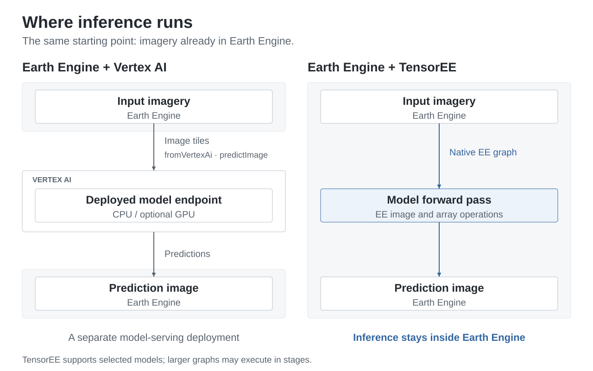
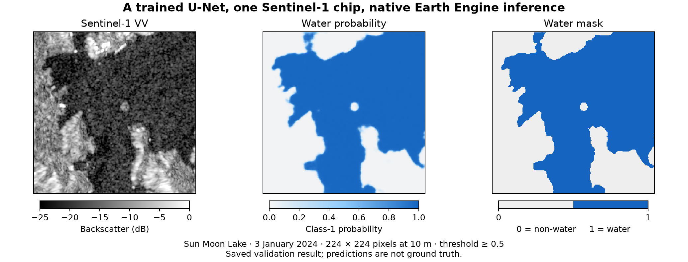
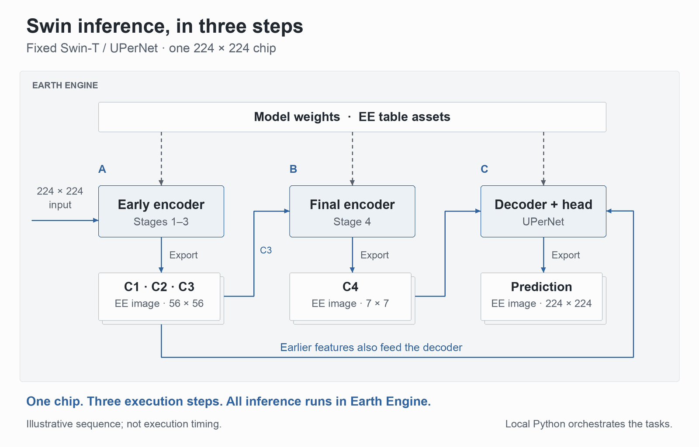

# TensorEE

[](https://github.com/noelEOS/tensor-ee/actions/workflows/tests.yml)
[](https://pypi.org/project/tensor-ee/)
[](https://doi.org/10.5281/zenodo.23524569)

**Run supported PyTorch models inside Google Earth Engine, without deploying a
model-serving endpoint.** TensorEE expresses neural-network inference as Earth Engine
image and array operations. Larger models can run in stages, saving intermediate
features as Earth Engine assets—from radar U-Nets to the 100M-parameter Prithvi
Sen1Floods11 model and supported vision transformers.



Python builds the computation graph; Earth Engine evaluates the forward pass. Weights
are embedded constants or reads from EE table assets. Unsupported operations are refused,
not approximated. The [Vertex AI integration](https://developers.google.com/earth-engine/guides/ee-vertex-overview)
shown alongside it uses a separately deployed model endpoint.

## From satellite imagery to flood predictions

**Prithvi Sen1Floods11 now runs inside Earth Engine with its released trained
checkpoint.** The workflow prepares six Sentinel-2 L1C bands, runs the encoder
and decoder in stages, and saves the prediction as an EE image asset.

On one 224 × 224 crop from the held-out Bolivia event, EE logits matched PyTorch
with a **largest absolute difference of 1.41e-5 and zero class disagreements**.
Water IoU against the hand label was **0.911 on that crop**—an example result,
not a benchmark or an established accuracy score.
[Workflow and preprocessing](https://github.com/noelEOS/tensor-ee/blob/main/docs/api.md#prithvi-sen1floods11) ·
[Recorded real-imagery run](https://github.com/noelEOS/tensor-ee/blob/main/docs/evidence/prithvi_sen1floods11-real-imagery-live.json)

The same model can process **a region of independent crops in each staged export**.
A trained 2 × 2 synthetic-crop run matched PyTorch within 6.11e-6, with zero class
changes. Crop edges keep their own padding; this is not overlapping slide inference.

**Also new: ViT-B/16 + DPT conversion.** Convert supported SMP DPT models at
224 × 224 to native EE graphs. Full-width conversion matches the hand-composed
graphs byte for byte; numerical and live evidence have narrower scope, detailed below.

### Radar water mapping



*A trained ResNet18 U-Net on one 224 × 224 Sentinel-1 chip: Sun Moon Lake, Taiwan,
3 January 2024. Prediction, not ground truth. [Validation](https://github.com/noelEOS/tensor-ee/blob/main/docs/validation.md) ·
[Walkthrough](https://github.com/noelEOS/tensor-ee/blob/main/docs/water-chip.md). Contains modified Copernicus Sentinel data (2024).*

## Get started

- **[Start here](https://github.com/noelEOS/tensor-ee/blob/main/docs/start-here.md).** New to TensorEE?
  A plain-language guide with three notebooks that run in Colab: a quickstart with the
  trained U-Net, a check of whether your own model is supported, and your own CNN from
  checkpoint to Earth Engine.
- **[Run the Code Editor demo](https://github.com/noelEOS/tensor-ee/blob/main/CODE_EDITOR.md).** No install or checkpoint. The trained
  U-Net reads public weights; you need an Earth Engine account and a
  [registered Cloud project](https://developers.google.com/earth-engine/guides/access)
  where you can create an image asset. The demo exports one chip, billed to your project.
- **[Try the offline example](https://github.com/noelEOS/tensor-ee/blob/main/README.md#install).** Build a small CNN's graph locally, with no
  credentials or cloud calls.
- **[Explore Prithvi flood inference](https://github.com/noelEOS/tensor-ee/blob/main/docs/api.md#prithvi-sen1floods11).**
  Follow the six-band preprocessing and staged workflow; this requires the released
  checkpoint and your own EE setup.
- **[Convert an attention model](https://github.com/noelEOS/tensor-ee/blob/main/docs/getting-started.md#5-convert-an-attention-model).**
  Start with random weights, inspect the conversion report, then plan the stages.

## What you can run

| Model or approach | Entry point | Availability |
|---|---|---|
| SegWater ResNet18 U-Net, 224 × 224 | [Code Editor demo](https://github.com/noelEOS/tensor-ee/blob/main/CODE_EDITOR.md); `compile_model` for CNNs | Trained EE weights are public; the Code Editor demo needs no checkpoint |
| Fixed Swin-T/UPerNet, 224 × 224 | [Three-stage workflow](https://github.com/noelEOS/tensor-ee/blob/main/docs/swin.md) | Trained EE weights are public; this workflow also needs a local checkpoint, not yet public |
| Prithvi Sen1Floods11, 224 × 224 crops | [Crop and region API](https://github.com/noelEOS/tensor-ee/blob/main/docs/api.md#prithvi-sen1floods11) | Released trained checkpoint; live evidence on synthetic crops and one real Sentinel-2 crop |
| SMP SegFormer-B0 or UPerNet with timm's Swin encoder | [Attention converter](https://github.com/noelEOS/tensor-ee/blob/main/docs/converter.md) | Conversion examples use random weights; the report identifies settings outside the validated records |
| SMP DPT + timm ViT-B/16, 224 × 224 | [DPT conversion](https://github.com/noelEOS/tensor-ee/blob/main/docs/converter.md#smp-050-dpt-at-224--224) | Random weights; full-width graph identity; full-width logits meet the 1e-4 target offline only; live evidence covers reduced twins |

You can also compose a model from the [block catalogue](https://github.com/noelEOS/tensor-ee/blob/main/docs/building-blocks.md).
It has 88 blocks: 23 in `tensor_ee/blocks/raster` and 65 in `tensor_ee/blocks/window`.
Recent additions include grouped/depthwise convolutions, bilinear upsampling,
standalone BatchNorm and input standardization. These expand the building blocks;
whole-model support still depends on the compiler or converter.
The [browser demo](https://github.com/noelEOS/tensor-ee/blob/main/DEMO.md) runs the SegWater and fixed Swin models with a local checkpoint;
its `--offline` mode previews the interface without one.

## Staged inference

Saving intermediate features lets a model run as several bounded EE graphs and avoids
recomputing earlier stages. In the fixed Swin workflow below, each step waits for its
predecessor's export to complete. The decoder reads both C4 and the earlier features.



*Illustrative sequence, not execution timing. [Static diagram](https://raw.githubusercontent.com/noelEOS/tensor-ee/main/docs/images/swin-staged-inference.png).*

Weights live in EE table assets; saved features and predictions live in EE image assets.
The checkpoint, manifest and task state are local files. This workflow needs no GCS bucket.
The [Swin guide](https://github.com/noelEOS/tensor-ee/blob/main/docs/swin.md) details the three steps, including the validity summary
saved with C1–C3. Other models can use different cuts: the [converter planner](https://github.com/noelEOS/tensor-ee/blob/main/docs/converter.md#3-plan)
chooses stages under explicit limits. Prithvi uses explicit cut lists and can resume
from saved encoder boundaries. Its measured merged-stage run reduced stage exports
from 33 to 16 with identical saved outputs; batch queue time meant wall time did
not fall. [Measurements and region execution](https://github.com/noelEOS/tensor-ee/blob/main/docs/api.md#prithvi-sen1floods11).

## Install

Python 3.11 or newer.

```sh
python -m pip install tensor-ee
```

Build a small CNN's graph offline, with no credentials or cloud calls:

```sh
python -m tensor_ee.examples.nonwater --prepare
```

Expect `"status": "offline_graph_only"` in the report.
[Getting started](https://github.com/noelEOS/tensor-ee/blob/main/docs/getting-started.md)
covers optional extras, PyTorch's download size and CPU-only installation, and the
steps for running in Earth Engine.

For the tests, tools, demos and checkout examples, install from source:

```sh
git clone https://github.com/noelEOS/tensor-ee.git
cd tensor-ee
python -m venv .venv && source .venv/bin/activate
python -m pip install '.[test]'
python -m pytest -q tests/test_nonwater_example.py
```

Expect `2 passed` from the example's tests.

## Evidence and limits

- **Experimental, with restricted support.** Only the settings in the
  [block catalogue](https://github.com/noelEOS/tensor-ee/blob/main/docs/building-blocks.md) have validation evidence. A conversion can
  report settings outside those records; converting them does not validate them.
- **Numerical agreement is not model accuracy.** The [model evidence](https://github.com/noelEOS/tensor-ee/blob/main/docs/model.md)
  records live comparisons with PyTorch and ONNX Runtime, offline graph identity,
  and the inputs each result covers. The absolute logit target is 1e-4; segmentation
  accuracy is not established; the Prithvi result above covers one labelled crop.
- **DPT evidence is limited.** Offline, with random weights, the full-width head and
  logits are within 2.06e-5 of float32 PyTorch, inside the 1e-4 target, with zero
  argmax flips. Two intermediate outputs differ from float32 PyTorch by more than 1e-4
  (largest 1.88e-4); intermediates are checked against float64 PyTorch instead.
  Live checks cover only reduced encoder and DPT twins with structured
  rank-at-most-4 projection weights (sampled DPT readouts), plus individual blocks.
  Full-width live execution remains unvalidated; no accuracy is claimed.
  [Evidence and scope](https://github.com/noelEOS/tensor-ee/blob/main/docs/converter.md#smp-dpt-vit-b16-evidence-and-scope).
- **Known U-Net exception.** The U-Net's synthetic upper-left impulse chip has a largest
  absolute logit difference of 1.6510487e-4, above the target; probabilities and the
  water mask agree ([record](https://github.com/noelEOS/tensor-ee/blob/main/docs/history/cnn/SEGWATER_PYTORCH_RESULTS.md)).
- **EE limits still apply.** Inference uses EE computation and storage, with their costs
  and quotas. The figures make no speed or cost comparison with Vertex AI.
- **Weights and training data.** The SegWater and fixed Swin models' EE weights are public under
  [CC BY 4.0](https://github.com/noelEOS/tensor-ee/blob/main/WEIGHTS-LICENSE.md); their [manifests](https://github.com/noelEOS/tensor-ee/tree/main/data/manifests/) list the assets.
  Their checkpoint files are not yet public. Their training used Sentinel-1 chips with water labels
  derived from Sentinel-2; a fuller dataset description is not yet published
  ([provenance](https://github.com/noelEOS/tensor-ee/blob/main/docs/model.md#training-data-and-provenance)).

## Documentation

[Getting started](https://github.com/noelEOS/tensor-ee/blob/main/docs/getting-started.md) · [API guide](https://github.com/noelEOS/tensor-ee/blob/main/docs/api.md) ·
[Converter guide](https://github.com/noelEOS/tensor-ee/blob/main/docs/converter.md) · [Block catalogue](https://github.com/noelEOS/tensor-ee/blob/main/docs/building-blocks.md) ·
[All guides and evidence](https://github.com/noelEOS/tensor-ee/blob/main/docs/README.md) ·
[Changelog](https://github.com/noelEOS/tensor-ee/blob/main/CHANGELOG.md)

## Licence, citation and attribution

Prithvi uses a separately released third-party checkpoint; consult its
[source and provenance](https://github.com/noelEOS/tensor-ee/blob/main/docs/api.md#prithvi-sen1floods11)
and upstream terms. The weight licence below applies to TensorEE’s SegWater and fixed Swin weights.

Code and documentation: [MIT](https://github.com/noelEOS/tensor-ee/blob/main/LICENSE). Trained weights: [CC BY 4.0](https://github.com/noelEOS/tensor-ee/blob/main/WEIGHTS-LICENSE.md),
including the checkpoints when published. Satellite data and third-party libraries keep
their own terms. The Sentinel-1 examples contain modified Copernicus Sentinel data (2024).
To cite TensorEE, use [CITATION.cff](https://github.com/noelEOS/tensor-ee/blob/main/CITATION.cff) or the DOI
[10.5281/zenodo.23524569](https://doi.org/10.5281/zenodo.23524569), which resolves to the latest
release; each release also has its own DOI on Zenodo. Record the version you used.

See [CONTRIBUTING](https://github.com/noelEOS/tensor-ee/blob/main/CONTRIBUTING.md) for contributions and [SECURITY.md](https://github.com/noelEOS/tensor-ee/blob/main/SECURITY.md) for
private vulnerability reports.
